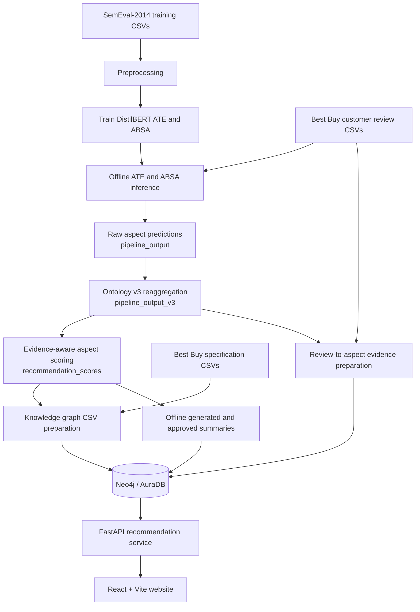

# Evidence-Aware Laptop Recommendation System

**Aspect Term Extraction · Aspect-Based Sentiment Analysis · Knowledge Graph · Explainable Recommendations**

An undergraduate thesis project that combines **DistilBERT-based Aspect Term Extraction (ATE) and Aspect-Based Sentiment Analysis (ABSA)** with a **Neo4j knowledge graph** to recommend laptops using hardware specifications, user preferences, and evidence from customer reviews.

Rather than assigning every laptop a single generic review rating, the system estimates sentiment for individual experience aspects—such as **battery life**, **performance**, and **thermal performance**—and explains both the resulting ranking and the amount of review evidence available.

**Project scope:** 30 laptops and 6,000 customer reviews in the research dataset; 24 stored canonical experience aspects, of which 23 are currently selectable for recommendation. These data and model files are **not included** in this source-only release.

> **Live demo:** [Open the deployed laptop recommendation website](https://laptop-recommendation-frontend.onrender.com). The deployed frontend requires a compatible populated Neo4j database.
> **Trained ATE/ABSA models:** *Google Drive download links to be added.* Each planned ZIP contains its respective `best_model/` export only.
> **Screenshots:** *To be added after selecting final application screenshots.*

## Contents

- [What the system does](#what-the-system-does)
- [Architecture and data flow](#architecture-and-data-flow)
- [Recommendation methodology](#recommendation-methodology)
- [Technology stack](#technology-stack)
- [Repository structure](#repository-structure)
- [Quick start: website](#quick-start-website)
- [Datasets, models, and offline pipeline](#datasets-models-and-offline-pipeline)
- [Testing and research scope](#testing-and-research-scope)
- [Data availability and limitations](#data-availability-and-limitations)

## What the system does

| Capability | Implementation |
|---|---|
| **Balanced recommendations** | Ranks laptops using equal weights across all 23 selectable experience aspects. |
| **Custom preferences** | Lets users choose aspects and assign their own weights; the backend normalizes them. |
| **Guided two-stage refinement** | Generates a Stage 1 shortlist (up to 10 laptops), verifies it server-side, then reranks **only those shortlisted laptops** using refined preferences. |
| **Hardware filtering** | Filters by price, RAM, storage, screen size, touchscreen, brand, processor, and graphics options. |
| **Explainable results** | Separates personalized recommendation score from evidence confidence; exposes per-aspect sentiment and the reviews supporting it. |
| **Laptop comparison** | Compares two or three laptops with specification tables, favorable/unfavorable numeric extremes, aspect sorting, and strongest/weakest review-sentiment radar charts. |
| **Coverage and missing evidence** | Identifies whether selected aspects have direct review evidence; displays **N/A** for unsupported individual experience scores rather than treating missing reviews as negative sentiment. |
| **Experience summaries** | Displays previously generated, human-approved strengths and weaknesses summaries, with UI-only emphasis of key phrases. No live generative-AI call is made during recommendations. |

The comparison radar charts visualize **review-derived sentiment**, not measured hardware benchmark performance. Hardware specification comparisons are rule-based; processor and GPU names are not automatically ranked as superior or inferior.

## Architecture and data flow

The NLP extraction, ontology mapping, and evidence-aware scoring happen **offline**. The deployed backend queries precomputed graph relationships and recalculates user-specific weighted rankings; it does **not** load DistilBERT for each website request.



The graph connects laptop entities to their manufacturer, processor, graphics processor, operating system, and canonical review aspects. Its `HAS_ASPECT_SCORE` relationships store adjusted sentiment scores and evidence statistics. Separately, `HAS_REVIEW` and `MENTIONS` relationships support traceable review-based explanations.

The graph preparation and recommendation pipeline can be investigated in `prepare_kg_data.py`, `recommendation_scoring.py`, `knowledge_graph/scripts/`, and `backend/app/services.py`.

## Recommendation methodology

For a given laptop–aspect pair, let **P**, **N**, **U**, and **M** represent counts of positive, negative, neutral, and mixed review-level sentiment, respectively, and let **n = P + N + U + M**.

The raw aspect sentiment is:

$$
R = \frac{P + 0.5U + 0.5M}{n}\quad (n>0)
$$

To reduce instability when an aspect has few reviews, the system uses an aspect-specific corpus-wide prior **G** and a prior strength of **k = 10** review equivalents:

$$
A = \frac{nR + kG}{n+k}
$$

Evidence confidence is recorded **separately**:

$$
C = \frac{n}{n+k}
$$

The user's active aspect weights are normalized to sum to 1, then applied to adjusted scores **A** for personalized ranking. Higher review counts imply greater support; **C is not a calibrated probability that a recommendation is correct**. Evidence support is also categorized as no evidence (0), insufficient (1–4), limited (5–9), moderate (10–19), or strong (20+).

For zero direct mentions, the scorer retains the corpus-wide prior internally with confidence 0. The website treats the laptop's *directly observed* aspect score as **N/A**. These behaviors avoid confusing missing review evidence with negative feedback.

### Guided refinement safeguards

Guided Stage 2 retains the original Stage 1 aspects, adds at least one new preference, verifies the Stage 1 shortlist on the server, and restricts Stage 2 ranking to that frozen candidate set. Changing preferences cannot silently introduce laptops that were never shortlisted.

## Technology stack

| Layer | Main technologies |
|---|---|
| Data preparation, scraping and analysis | Python 3.11, Pandas, NumPy, Selenium, scikit-learn, Matplotlib |
| ATE / ABSA | PyTorch, Hugging Face Transformers, DistilBERT |
| Ontology and scoring | Python, canonical aspect mapping, evidence-adjusted sentiment aggregation |
| Knowledge graph | Neo4j / AuraDB, Cypher, Neo4j Python driver |
| API | FastAPI, Pydantic, Uvicorn |
| Website | React, Vite, JavaScript, CSS |
| Deployment | GitHub-connected Render services (frontend and backend) |

## Repository structure

```text
.
├── backend/                       # FastAPI service and Neo4j configuration template
├── frontend/                      # React/Vite UI, frontend tests and npm lockfile
├── knowledge_graph/
│   ├── scripts/                   # Graph import, review evidence and summary workflows
│   ├── data/                      # Placeholder: prepared graph CSVs
│   ├── review_evidence/           # Placeholder: review evidence CSVs
│   └── generated_summaries/       # Placeholder: offline approved summaries
├── SemEval_2014_dataset/          # Placeholder: downloaded training CSVs
├── aspect_extraction/             # Placeholder: ATE best_model download
├── aspect_sentiment/              # Placeholder: ABSA best_model download
├── reviews/                        # Placeholder: original laptop review CSVs
├── specifications/                # Placeholder: original laptop specification CSVs
├── pipeline_output/               # Raw ATE/ABSA predictions
├── pipeline_output_v3/            # Final ontology-normalized outputs
├── recommendation_scores/         # Final evidence-adjusted aspect scores
├── tests/                         # Python regression tests
├── docs/                          # Environment, data and verification documentation
├── Data_preprocessing.py          # SemEval data preparation
├── ATE_train_model.py             # ATE model training/evaluation
├── ABSA_train_model.py            # ABSA model training/evaluation
├── ATE_ABSA_Pipeline.py           # Offline inference on laptop reviews
├── aspect_ontology.py             # Canonical aspect mapping
├── reaggregate_ontology_v3.py     # Final ontology reaggregation
├── recommendation_scoring.py      # Global priors, adjustment and confidence
├── prepare_kg_data.py            # Neo4j-ready CSV generation
├── requirements-ml.txt            # Offline Python direct dependencies
└── README.md
```

Other retained source modules include the review/specification scrapers and standalone graph verification or query scripts. Placeholder directories contain `.gitkeep` so their paths remain available after cloning.

## Quick start: website

> **Prerequisite:** access to a compatible, **already populated Neo4j graph**. This source-only clone contains neither the complete laptop dataset nor the precomputed graph import CSVs; cloning the repository alone cannot create working recommendation data.

These commands are for **Windows PowerShell**. Run backend commands from the repository root. Use Python **3.11** and a current Node.js **20+ LTS** release.

**Terminal 1 — API:**

```powershell
py -3.11 -m venv .venv
.\.venv\Scripts\Activate.ps1
python -m pip install -r backend/requirements.txt
Copy-Item backend/.env.example backend/.env
# Edit backend/.env with your OWN Neo4j URI, username, password and database.
uvicorn backend.app.main:app --reload
```

The API normally runs at `http://127.0.0.1:8000`. Its interactive OpenAPI documentation is at `http://127.0.0.1:8000/docs`. Use `GET /api/health` to check database connectivity.

**Terminal 2 — website:**

```powershell
cd frontend
npm ci
Copy-Item .env.example .env.local
# Keep VITE_API_BASE_URL=http://127.0.0.1:8000 for local development.
npm run dev
```

Open `http://localhost:5173`. For a production build, run `npm run build` from `frontend/`.

**Never commit** your real `backend/.env`; the frontend must not contain Neo4j passwords. Additional backend and frontend instructions are in [Environment setup](docs/ENVIRONMENT_SETUP.md), [Backend README](backend/README.md), and [Frontend README](frontend/README.md).

### API endpoints

| Method | Endpoint | Purpose |
|---|---|---|
| `GET` | `/api/health` | Database connectivity health check |
| `GET` | `/api/aspects` | Available canonical experience aspects |
| `GET` | `/api/filters` | Supported filter values from the graph |
| `GET` | `/api/laptops/{laptop_id}` | Laptop specifications and aspect detail |
| `GET` | `/api/laptops/{laptop_id}/aspects/{aspect_id}/evidence` | Sentiment-diverse source review evidence |
| `POST` | `/api/recommendations` | Weighted ranking with hard specification filters |
| `POST` | `/api/recommendations/refine` | Verified two-stage shortlist refinement |

## Datasets, models, and offline pipeline

### 1. SemEval-2014 training data

The dataset is **not included** in this repository. Download `archive.zip` from the [Kaggle SemEval-2014 Task 4 dataset](https://www.kaggle.com/datasets/charitarth/semeval-2014-task-4-aspectbasedsentimentanalysis) used in this project. Its required CSV files are in the archive's top level. Copy **only** these two files into the existing `SemEval_2014_dataset/` placeholder:

```text
SemEval_2014_dataset/
├── Laptop_Train_v2.csv
└── Restaurants_Train_v2.csv
```

From the repository root:

```powershell
python Data_preprocessing.py
```

This creates `SemEval_2014_dataset/Final_SemEval.csv`, the input expected by both training scripts. The preprocessing combines the laptop and restaurant examples, removes examples without annotated aspects, and excludes the `conflict` class. The script displays interactive sentiment charts.

### 2. Offline research dependencies and trained models

For model work, install the correct **PyTorch CPU/CUDA build** from the [official PyTorch selector](https://pytorch.org/get-started/locally/) before installing:

```powershell
python -m pip install -r requirements-ml.txt
```

The author's development environment was **Python 3.11.0** with a CUDA-specific PyTorch build; the file intentionally does not force that GPU build on other computers. Dependency versions were transcribed from the author's local environment and have **not** been validated as a fresh cross-platform installation. See [Dependency notes](docs/DEPENDENCY_NOTES.md).

The planned separately hosted archives are:

| Google Drive archive | Extracted path | Download |
|---|---|---|
| `aspect_extraction.zip` | `aspect_extraction/best_model/` | *Link pending* |
| `aspect_sentiment.zip` | `aspect_sentiment/best_model/` | *Link pending* |

Extract the actual `best_model/` folder under each parent; do **not** create an accidental nested `aspect_extraction/aspect_extraction/` path. Intermediate `checkpoint-*` folders are unnecessary for final inference. Once the training CSV exists, optional retraining entry points are `python ATE_train_model.py` and `python ABSA_train_model.py`; GPU resources and additional compatible Hugging Face training dependencies may be required.

### 3. Regenerate prediction, ontology and scoring artifacts

**Requires:** the full original 30-laptop review CSVs under `reviews/` and both final trained models above. These full review files are **not** distributed in this repository.

```powershell
python ATE_ABSA_Pipeline.py --reviews-dir reviews --output-dir pipeline_output
python reaggregate_ontology_v3.py --raw pipeline_output/raw_aspect_predictions.csv --output-dir pipeline_output_v3
python recommendation_scoring.py
```

`pipeline_output/` is the raw-inference output location. `reaggregate_ontology_v3.py` does **not** infer the input path: its `--raw` option is mandatory. The script writes the final ontology aggregations to `pipeline_output_v3/`, and `recommendation_scoring.py` reads its experience summary by default.

### 4. Prepare and populate Neo4j

**Requires:** validated final aspect scores, the complete original specification CSVs under `specifications/`, and access to a Neo4j database you are authorized to modify.

```powershell
python prepare_kg_data.py
python knowledge_graph/scripts/create_neo4j_graph.py
```

The first command prepares graph-import CSVs. The second **writes to the configured database**; verify `backend/.env` and your target instance **before running it**, and use a test database for reproduction. Avoid `--clear-existing` unless you intend to erase all existing graph data.

To add review provenance, which requires the original review CSVs and ontology output:

```powershell
python knowledge_graph/scripts/prepare_review_evidence.py
python knowledge_graph/scripts/import_review_evidence.py
python knowledge_graph/scripts/verify_neo4j_graph.py
python knowledge_graph/scripts/verify_review_evidence.py
```

The project's existing laptop summary generation/import workflow operates **offline**, uses approved drafts and source-data hash checks, and is documented in `knowledge_graph/scripts/generate_laptop_summaries.py` and `knowledge_graph/scripts/import_laptop_summaries.py`. Generating new summaries may require an external AI API key; the published recommendation API does not. Do not apply summary imports to a live graph without reviewing the drafts and checking data consistency.

## Testing and research scope

To verify this source-only release, run the following commands:

```powershell
python -m pytest -q tests/test_two_stage_refinement.py tests/test_laptop_summaries.py
cd frontend
node test_display_all.mjs
node test_supervisor_comparison.mjs
node test_supervisor_four_refinements.mjs
node test_summary_coverage.mjs
npm run build
```

The Stage 4 package passed the Python and Node-based regression suites; a fresh `npm ci` and full Vite production build were **not rerun here**. Some summary tests are deliberately skipped when `recommendation_scores/laptop_aspect_scores.csv` is absent. Tests that need Neo4j, model weights, source data, or a deployed service cannot be exercised from a source-only clone. See [Stage 3 verification](docs/STAGE3_VERIFICATION.md) and the [publication checklist](docs/README_PUBLICATION_CHECKLIST.md) for the exact scope.

**Dataset and graph size in the validated private research artifacts:** 30 laptops; 6,000 review nodes; 24 stored aspect nodes; 720 laptop–aspect score relationships. The corrected final data and its audit record are held privately, not in this repository.

## Data availability and limitations

- **SemEval-2014:** Obtain from the linked source, subject to its distribution terms. Only two CSVs are required by the project's existing preprocessing script.
- **ATE and ABSA model weights:** To be hosted separately on Google Drive as the final `best_model/` exports.
- **Laptop reviews and specifications:** The complete 30-laptop source datasets are excluded. Consequently, this repository alone does **not** reproduce the populated knowledge graph end-to-end.
- **Neo4j credentials:** Never included. The website requires a populated graph supplied or reconstructed separately.
- **Review provenance:** Full scraped consumer review text/evidence snippets are not published here; redistribution permissions must be checked before sharing them.
- **Results interpretation:** Review sentiment and available evidence are not direct performance measurements. The study covers a fixed dataset and product specifications/prices may become outdated.

The validated final dataset and historical correction/audit materials are retained in a **separate private research archive**. This repository presents the finalized source code and does not distribute obsolete intermediate datasets. See [Data setup and limitations](docs/DATA_SETUP_AND_LIMITATIONS.md).

---

**Academic project:** Undergraduate thesis implementation. The repository is being prepared for university code submission and a future public portfolio. **Screenshots, model downloads, an explicit repository license, and final publication checks remain pending.**
